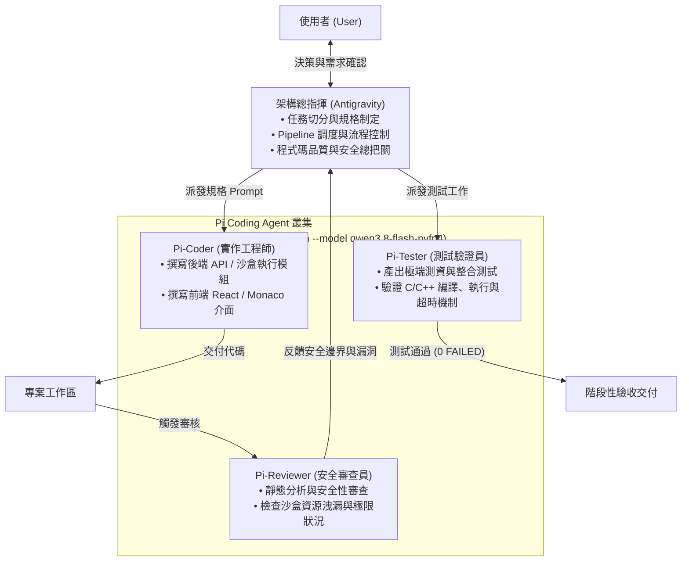

# Multi-Agent Coding System Architecture (AGENTS.md)

本文件定義 **CodingPass** 專案所採用的 Multi-Agent 協作開發系統架構、角色分工、派工調度方式以及安全性規範。

---

## 1. 架構概述 (Architecture Overview)

本系統採用 **「總指揮 (Orchestrator) + 特化型 Worker Agents」** 的階層式多 Agent 協作架構：



---

## 2. Agent 角色定義與 Prompt 規範

所有 Pi Worker Agent 均由本地 `pi` CLI 搭配 `--provider ttu-vllm --model qwen3.8-flash-nvfp4` 驅動，依角色注入專屬 System Prompt：

### 2.1 Orchestrator (總指揮 - Antigravity)
- **職責**：整體架構規劃、專案管理、需求分解為原子任務、調度 Pi Agent 執行、跨 Agent 輸出整合與驗收交付。
- **原則**：不在第一時間親自撰寫大量繁雜代碼，盡可能 offload 給 `pi`，專注於邊界條件思考與架構健全性。

### 2.2 Pi-Coder (實作工程師)
- **核心設定**：
  ```bash
  --append-system-prompt "You are Pi-Coder, a senior software engineer specializing in C, C++, Python (FastAPI), and modern web frontend (React/TypeScript/Tailwind). Your task is to implement clean, robust, well-documented, and production-ready code. Adhere strictly to project specifications and write safe code with error handling."
  ```
- **職責**：後端核心模組、RESTful 端點、前端元件與 Monaco Editor 整合。

### 2.3 Pi-Reviewer (代碼與安全審查員)
- **核心設定**：
  ```bash
  --append-system-prompt "You are Pi-Reviewer, a principal software architect and security auditor. Your role is to rigorously review code changes, identify security risks (especially in subprocess sandboxing, memory management, infinite loops, fork bombs), edge cases, and propose actionable fixes or approve the implementation."
  ```
- **職責**：專門審查 C/C++ 沙盒逃逸風險、Subprocess 殭屍進程、記憶體溢出（OOM）、無窮迴圈、系統資源限制。

### 2.4 Pi-Tester (測試驗證員)
- **核心設定**：
  ```bash
  --append-system-prompt "You are Pi-Tester, a QA automation engineer. Your role is to write comprehensive unit, integration, and edge-case tests, execute them, and verify that the system handles various scenarios correctly (including compilation errors, timeouts, large stdin/stdout, and crashes)."
  ```
- **職責**：編寫自動化測試腳本（如 `test_judge.py`），模擬各種學生可能提交的惡意或邊界程式碼。

---

## 3. 調度工具：`scripts/agent_dispatch.py`

專案提供封裝好的 Python 調度工具，簡化指令並支援非互動式 (`-p`) 自動執行：

### 常用指令範例：

```bash
# 調度 Pi-Coder 編寫前端代碼
./scripts/agent_dispatch.py coder "實作 frontend/src/components/Editor.tsx 支援 C/C++ 語法切換"

# 調度 Pi-Reviewer 審查特定模組安全性
./scripts/agent_dispatch.py reviewer "檢查 backend/compiler.py 在多執行緒下的記憶體釋放機制" -f backend/compiler.py

# 調度 Pi-Tester 擴充測試用例
./scripts/agent_dispatch.py tester "為 backend/test_judge.py 新增大型 stdin 輸入與超大輸出的截斷測試"
```

---

## 4. 關鍵經驗與沙盒安全防護守則 (Hard-Learned Safety Guidelines)

在開發評測沙盒時，曾因測試用例 `for(int i=0; i<40; i++) fork();` 產生指數級進程（$2^{40}$），瞬間耗盡 Linux 系統之 `RLIMIT_NPROC`（最大進程數限額），導致宿主機無可用進程槽（`Resource temporarily unavailable`）而當機。

為防止學生代碼或測試代碼再次威脅伺服器穩定，多 Agent 系統制定了以下**沙盒防護鐵律**：

1. **嚴禁在主機直接執行無限制的進程生成測試**：測試多進程防護時，使用受控的極小次數（如 3 次 fork），檢驗 session process group kill 是否生效即可。
2. **多層資源限制 (rlimit)**：
   - `RLIMIT_CPU`：設定嚴格 CPU 秒數，超時觸發核心發送 `SIGXCPU` / `SIGKILL`。
   - `RLIMIT_AS`：限制虛擬記憶體（預設 256MB），超額立即觸發 `bad_alloc` 或 `SIGSEGV`。
   - `RLIMIT_FSIZE`：限制子進程寫入檔案大小，防止塞爆硬碟。
   - `RLIMIT_CORE = 0`：禁止產生 core dump，節省 I/O 與儲存空間。
3. **Process Group 隔離 (`os.setsid`)**：子進程獨立群組，超時由裁判端調用 `os.killpg(proc.pid, signal.SIGKILL)` 徹底清理，防止孤兒進程殘留。
4. **未來生產環境隔離升級**：在正式對外服務階段，應引入 Linux namespace、cgroups v2、或專屬輕量容器（如 `nsjail` / Docker / Podman），徹底隔離宿主機 PID 命名空間。
